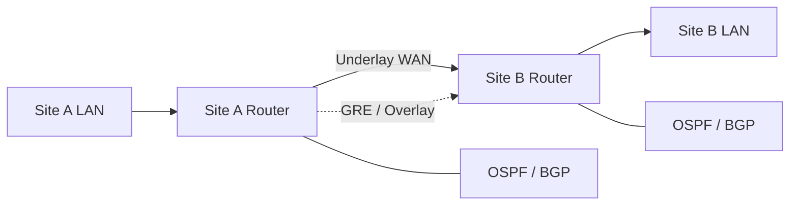

# Documentation Guide - Network Engineering

Use this structure for new protocol, device, architecture and troubleshooting pages. Keep it practical. A short page with accurate checks is better than a long page full of generic claims.

## Required labels

At the top of each page, identify one or more of these:

- **Production experience:** Work I have been involved in. Describe scope and responsibility without confidential details.
- **Sanitized reference:** A reduced/anonymized configuration or source-derived reference. State what was removed and what is incomplete.
- **Lab/demo:** An independently authored example. State the platform/release and whether it was actually tested.
- **Design note:** An architecture or packet-flow explanation.
- **Template:** A reusable checklist or workflow, not a record of an actual event.

Do not imply a lab was deployed in production. Do not imply a sanitized excerpt is a complete backup.

## Page structure

1. **Purpose and scope** - What problem or technology does this page cover?
2. **Evidence and environment** - Evidence label, vendor/model, software release, source date if known, lab topology if applicable.
3. **Topology and packet flow** - Add a Mermaid diagram when it helps explain peers, interfaces, underlay/overlay, VLANs or traffic direction.
4. **Prerequisites and dependencies** - Addressing, interfaces, routing, licenses, MTU, firewall policy, upstream services.
5. **Configuration example** - Sanitized commands with fictional names and documentation-only IPs. Explain each meaningful block.
6. **Troubleshooting** - Symptom, checks, likely causes, evidence and safe next step.
7. **Verification** - Commands to confirm state and what a healthy result should look like.
8. **Change safety and rollback** - Backup/baseline, maintenance window, rollback trigger and recovery steps.
9. **What I learned** - A short note about an assumption, unexpected result, limitation or next thing to test.
10. **References** - Vendor documentation and related repository pages.

## Example topology

Adapt the diagram to the actual example. Do not add devices, redundancy or protocols that are not part of the described design.

## Example troubleshooting table

| Symptom | Checks | Possible cause | Verification |
|---|---|---|---|
| OSPF neighbor not full | Interface state, area, timers, MTU, authentication, reachability | Underlay or adjacency mismatch | Neighbor state and route table |
| GRE tunnel up but routes missing | Tunnel source/destination, reachability, OSPF interface/network type, MTU | Overlay or routing issue | Tunnel counters, adjacency and learned routes |
| BGP session down | Peer reachability, source address, ASN, TCP 179, policy | Underlay, peer or policy issue | BGP summary and received/advertised routes |
| VLAN host unreachable | Access VLAN, trunk allow-list, STP, gateway and MAC learning | Layer 2 or gateway mismatch | MAC table, VLAN state and end-to-end test |

These are investigation prompts, not a diagnosis. Confirm the actual cause from evidence.

## Configuration and security rules

- Use placeholders such as `<WAN_INTERFACE>` and fictional documentation addresses.
- Never publish credentials, keys, communities, real customer/provider details or raw production backups.
- Mark commands that are illustrative or untested.
- Do not claim device/parser validation unless it was performed on the named platform and release.
- Explain destructive commands and include a rollback or recovery note.
