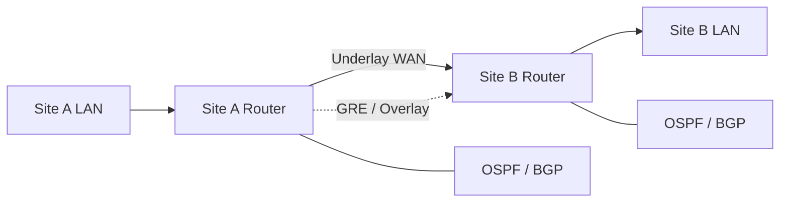

# How I document network work

I use these notes when adding a device, protocol, design or troubleshooting page. I do not want a document to look complete just because it has many headings. It should help someone understand the setup, follow the checks and see what has or has not been tested.

## First, explain what the page is

Choose the description that fits the material:

- **Production experience:** A task or area of work I was involved in. Keep company, customer and site details private.
- **Sanitized reference:** A shortened or anonymized example based on a source configuration. Say what was changed or left out.
- **Lab/demo:** Something I built or tested separately. Mention the device/software release and the checks I actually ran.
- **Design note:** An explanation of a topology, traffic flow or design choice.
- **Template:** A checklist or workflow that someone still needs to adapt.

A lab is not proof of a production deployment. A shortened configuration should not be mistaken for a complete device backup.

## What I try to include

1. **The problem or purpose.** What am I trying to explain or fix?
2. **The environment.** Device model, software release, relevant source date and lab details, where known.
3. **The topology.** A diagram if it makes the links, peers, VLANs or traffic path easier to follow.
4. **Dependencies.** Interfaces, addressing, routing, MTU, licenses, firewall rules and upstream services.
5. **The example.** Sanitized commands, with a short explanation of the parts that matter.
6. **Troubleshooting.** What the symptom looks like, what I checked and what the evidence showed.
7. **Verification.** The commands or tests used, plus the result that indicates the service is healthy.
8. **Change safety.** Baseline or backup, maintenance window, rollback trigger and recovery steps.
9. **A useful lesson.** Something that surprised me, an assumption that was wrong, or a point I still need to test.
10. **References.** Vendor documentation and related pages.

Not every short note needs all ten sections. Use what helps explain the work; leave out headings that have nothing useful to say.

## Example topology

Change the diagram to match the actual example. Do not add redundancy, devices or protocols just to make the design look more impressive.

## Example troubleshooting table

| Symptom | What I would check | Possible area | How to confirm |
|---|---|---|---|
| OSPF neighbor not full | Interface state, area, timers, MTU, authentication and reachability | Underlay or adjacency mismatch | Neighbor state and route table |
| GRE tunnel up but routes missing | Tunnel endpoints, reachability, OSPF interface/network type and MTU | Overlay or routing issue | Tunnel counters, adjacency and learned routes |
| BGP session down | Peer reachability, source address, ASN, TCP 179 and policy | Underlay, peer or policy issue | BGP summary and received/advertised routes |
| VLAN host unreachable | Access VLAN, trunk allow-list, STP, gateway and MAC learning | Layer 2 or gateway mismatch | MAC table, VLAN state and end-to-end test |

These checks help narrow down an issue. They are not a diagnosis until the evidence points to a cause.

## Before publishing or running an example

- Replace real names and addresses with safe placeholders or documentation ranges.
- Remove passwords, keys, SNMP communities, customer/provider details and raw production backups.
- Mark examples that are illustrative or still untested.
- Only say a configuration passed a parser or device check when that test was actually run on the named platform and release.
- Explain commands that can interrupt service or remove configuration, and include a recovery path.
