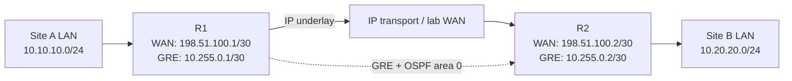

# Lab Walkthrough: OSPF over GRE Between Two Sites

**Evidence type:** Lab/demo reference  
**Platform:** Cisco IOS / IOS-XE-style CLI (syntax and feature support vary by release)  
**Purpose:** Build a routed GRE overlay across a simple IP underlay, form an OSPF adjacency over the tunnel, advertise one LAN from each site, and verify end-to-end reachability.  
**Status:** Configuration example for controlled lab use. Do not interpret this as a record of a production device configuration or as a claim of physical-device validation.

## 1. What this lab is meant to teach

A GRE tunnel gives two routers a logical point-to-point path across an IP network. OSPF can then exchange routes over that logical interface.

The important distinction is:

- **Underlay:** ordinary IP reachability between the WAN addresses used as GRE endpoints.
- **Overlay:** the GRE tunnel interface and the OSPF adjacency/routes carried across it.
- **Service path:** traffic from a host behind Site A to a host behind Site B, and the return path.

A tunnel interface being up does not prove OSPF is adjacent, routes are installed, or applications are reachable.

## 2. Topology and addressing



| Item | Site A / R1 | Site B / R2 |
|---|---|---|
| WAN interface | G0/0 | G0/0 |
| WAN address | 198.51.100.1/30 | 198.51.100.2/30 |
| LAN interface | G0/1 | G0/1 |
| LAN gateway | 10.10.10.1/24 | 10.20.20.1/24 |
| GRE interface | Tunnel0 | Tunnel0 |
| GRE address | 10.255.0.1/30 | 10.255.0.2/30 |
| OSPF process | 10 | 10 |
| OSPF area | 0 | 0 |

All addresses are documentation-only examples. In this small lab, the WAN endpoints share a directly connected /30. In a real routed underlay, verify that each GRE destination resolves through the intended transport and not recursively through the GRE tunnel.

## 3. Before configuration

1. Confirm both routers support GRE and OSPF in the selected software image.
2. Confirm the WAN interfaces and underlay path are operational.
3. Confirm the GRE endpoint addresses can reach each other before the tunnel exists.
4. Confirm the LAN subnets do not overlap.
5. Save a baseline configuration and use a lab or approved maintenance window.
6. GRE does not encrypt traffic. Do not carry sensitive traffic over an untrusted transport without an approved security design such as GRE protected by IPsec.

## 4. Configuration - R1 / Site A

The example assumes G0/0 faces the lab transport and G0/1 faces the Site A LAN. Adapt interface names to the actual platform.

```cisco
hostname R1

interface GigabitEthernet0/0
 description LAB-UNDERLAY-TO-R2
 ip address 198.51.100.1 255.255.255.252
 no shutdown

interface GigabitEthernet0/1
 description SITE-A-LAN
 ip address 10.10.10.1 255.255.255.0
 no shutdown

interface Tunnel0
 description GRE-OVERLAY-TO-SITE-B
 ip address 10.255.0.1 255.255.255.252
 tunnel source GigabitEthernet0/0
 tunnel destination 198.51.100.2
 tunnel mode gre ip
 ip ospf 10 area 0
 ip ospf network point-to-point
 no shutdown

router ospf 10
 router-id 10.10.10.1
 passive-interface default
 no passive-interface Tunnel0
 network 10.10.10.0 0.0.0.255 area 0
```

## 5. Configuration - R2 / Site B

```cisco
hostname R2

interface GigabitEthernet0/0
 description LAB-UNDERLAY-TO-R1
 ip address 198.51.100.2 255.255.255.252
 no shutdown

interface GigabitEthernet0/1
 description SITE-B-LAN
 ip address 10.20.20.1 255.255.255.0
 no shutdown

interface Tunnel0
 description GRE-OVERLAY-TO-SITE-A
 ip address 10.255.0.2 255.255.255.252
 tunnel source GigabitEthernet0/0
 tunnel destination 198.51.100.1
 tunnel mode gre ip
 ip ospf 10 area 0
 ip ospf network point-to-point
 no shutdown

router ospf 10
 router-id 10.20.20.1
 passive-interface default
 no passive-interface Tunnel0
 network 10.20.20.0 0.0.0.255 area 0
```

### Why these lines matter

- The WAN interfaces provide the underlay path between GRE endpoints.
- Tunnel source and destination identify the outer GRE endpoints.
- The tunnel addresses form the overlay point-to-point subnet.
- OSPF is enabled on Tunnel0, not on the public/transport-facing interface.
- The LAN network statement advertises the local LAN. Passive-interface default prevents OSPF hellos from being sent to end-user LAN segments.
- The OSPF router IDs must be unique in the routing domain.
- Point-to-point OSPF network type is used here to avoid a DR/BDR election on this logical link. Confirm platform support and design requirements.

## 6. Verification - work from the outside in

Run checks on both routers. Command availability and output vary by IOS/IOS-XE release.

### A. Underlay

```cisco
show ip interface brief
show ip route 198.51.100.2
ping 198.51.100.2 source 198.51.100.1
```

On R2, reverse the source and destination. The remote GRE endpoint must be reachable independently of the overlay.

### B. GRE interface

```cisco
show interface Tunnel0
show ip interface Tunnel0
show running-config interface Tunnel0
```

Check line/protocol state, source/destination, packet counters, drops and MTU. An interface state of up/up alone is not end-to-end proof.

### C. OSPF adjacency and routes

```cisco
show ip ospf neighbor
show ip ospf interface Tunnel0
show ip ospf database
show ip route ospf
show ip protocols
```

Expected lab result:

- One OSPF neighbor reaches FULL over Tunnel0.
- R1 learns 10.20.20.0/24 through OSPF.
- R2 learns 10.10.10.0/24 through OSPF.
- The next hop and outgoing interface point to the GRE overlay as expected.

### D. End-to-end service path

From R1, test the Site B LAN gateway using the tunnel as the source where supported:

```cisco
ping 10.20.20.1 source 10.255.0.1
traceroute 10.20.20.1
```

Repeat in the reverse direction. For a real service, test an approved host/application endpoint, not only router interfaces.

## 7. Troubleshooting decision table

| Symptom | First checks | Common causes to investigate |
|---|---|---|
| Tunnel protocol down | Underlay route, source interface, destination reachability, GRE counters | WAN outage, wrong source/destination, filtering of GRE (IP protocol 47) |
| Tunnel up, OSPF neighbor absent | Tunnel IP/mask, OSPF enabled, area, hello/dead timers, authentication, ACL | OSPF not enabled on tunnel, parameter mismatch, protocol 89 filtered |
| Neighbor stuck in INIT/2-WAY/EXSTART | Neighbor detail, MTU, network type, duplicate router ID, packet visibility | One-way hellos, MTU mismatch, network-type mismatch, duplicate ID |
| Neighbor FULL, remote LAN route missing | OSPF database, passive settings, network statements, route filters | LAN not advertised, wrong mask/area, filtering |
| Route installed, application fails | Return route, host gateway, ACL/firewall, NAT, MTU/MSS, endpoint service | Asymmetric path, host firewall, path MTU issue, application issue |
| Intermittent adjacency | Interface errors, loss, latency, CPU, tunnel counters, logs | Unstable underlay, congestion, MTU/fragmentation, resource pressure |

Use evidence from both ends before deciding on a cause. Do not change multiple variables at once during fault isolation.

## 8. MTU and fragmentation

GRE adds an outer IP header and GRE header; additional encapsulation such as IPsec reduces usable payload further. The exact overhead depends on address family, GRE options and security encapsulation.

- Check the transport's actual path MTU rather than assuming a universal tunnel MTU.
- Test with appropriate DF/size probes where supported.
- Review interface drops and fragmentation counters.
- Consider TCP MSS adjustment only after confirming the path-MTU requirement and platform behavior.
- Record the chosen MTU/MSS and the test evidence in the lab notes.

Do not copy a generic MTU value into production without measuring the path and checking all encapsulation layers.

## 9. Change, rollback and recovery

For a controlled lab, save the starting configuration before changes. For production work, follow the organization's change approval and maintenance process.

Before a production change, document:

- Affected sites, prefixes, applications and owners.
- Current underlay routes, tunnel state, OSPF neighbors and route table.
- Configuration backup and out-of-band access/recovery method.
- Expected outcome and clear rollback trigger.
- Stakeholder communication and validation window.

Rollback should restore the last known-good configuration using the platform's approved procedure. After rollback or correction, re-check underlay reachability, tunnel state, OSPF adjacency, expected routes and application path.

## 10. What I would record after the lab

- Platform model and exact software release tested.
- Commands that were accepted and any syntax differences.
- Baseline and final OSPF neighbor state.
- Expected and observed route table entries.
- Bidirectional ping/traceroute or application test results.
- MTU test method and result.
- Any issue encountered, the evidence used, the correction and what I learned.

Do not mark this lab as validated until you have actually run it and captured your own results.

## 11. References

- [Cisco OSPF configuration documentation](https://www.cisco.com/c/en/us/support/docs/ip/open-shortest-path-first-ospf/7039-1.html)
- [Cisco GRE configuration guidance](https://www.cisco.com/c/en/us/support/docs/ip/generic-routing-encapsulation-gre/118361-technote-gre-00.html)
- [OSPF RFC 2328](https://www.rfc-editor.org/rfc/rfc2328)
- [GRE RFC 2784](https://www.rfc-editor.org/rfc/rfc2784)

## Related portfolio pages

- [OSPF over GRE operational case study](./ospf-over-gre-multisite-routing.md)
- [Connectivity and DC/DR operations](../connectivity-operations/README.md)
- [Tunnel technologies](../tunnels/README.md)
- [Network documentation guide](../DOCUMENTATION-GUIDE.md)

---

**A note on this documentation:** The technical work and experience behind these notes are mine. Some wording and the way I have organized the material have had AI assistance, mainly to make the writing clearer and save time. The examples, decisions and work described are not AI-generated. I check what I publish and stand behind it.
