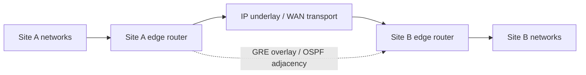

# Case Study: OSPF over GRE for Multi-site Connectivity

**Focus:** Overlay routing, GRE tunnel operations and multi-site reachability  
**Evidence type:** Sanitized production-experience summary with a separate lab walkthrough  
**Environment:** Enterprise/ISP routed connectivity  
**Disclosure:** Actual peer addresses, site names, routing policies, device identifiers and production configurations are intentionally excluded.

## Operational context

Some routed networks require dynamic routing across an IP transport where the underlay does not carry the required routing protocol directly. GRE can provide a logical point-to-point or multipoint overlay, while OSPF exchanges routes across the tunnel.

My documented hands-on scope includes GRE tunnel connectivity and OSPF routing over GRE in production network operations. This page describes the operational considerations and verification approach. It does not publish a customer topology, raw production configuration or measured availability result.

## Logical architecture

- The underlay provides IP reachability between tunnel endpoints.
- GRE encapsulates overlay packets between the configured endpoints.
- OSPF exchanges the intended site prefixes across the tunnel.
- Route policy and filtering control which prefixes are accepted and advertised.
- Monitoring should check tunnel health, routing adjacency and end-to-end service reachability separately.

## Packet and routing flow

1. A site router selects the GRE tunnel as the next hop for a remote site prefix.
2. The router encapsulates the original packet in GRE and forwards the outer packet using the underlay route to the remote tunnel endpoint.
3. The remote router decapsulates the GRE packet and forwards the inner packet according to its routing table.
4. OSPF hello and routing packets use the tunnel interface, subject to the platform's interface and network-type behavior.
5. Return traffic must have a valid route through the intended reverse path.

## Pre-change checks

- Confirm underlay reachability between tunnel endpoints in both directions.
- Confirm that the tunnel destination resolves through the intended underlay and not recursively through the same tunnel.
- Review tunnel source/destination, addressing, MTU and keepalive behavior where supported.
- Confirm OSPF process, area, interface participation, authentication and network type as required by the design.
- Review route filters, metrics, passive-interface settings and expected advertised prefixes.
- Check for overlapping addressing and unintended route redistribution.
- Define change approval, maintenance window, baseline, rollback and stakeholder communication.

## Verification workflow

| Layer | Verification |
|---|---|
| Underlay | Peer reachability, route to tunnel destination, latency/loss where monitored |
| GRE | Tunnel interface state, source/destination, counters, MTU and keepalive status |
| OSPF | Neighbor state, adjacency stability, area/interface parameters and learned routes |
| Routing | Expected prefixes, next-hop resolution, route preference and filtering |
| Service | Bidirectional reachability to approved test endpoints and application checks |
| Monitoring | Interface/tunnel status, routing adjacency alerts and service-path visibility |

A tunnel showing as up is not sufficient evidence of service availability. Validate routing and the actual service path in both directions.

## Troubleshooting sequence

1. Check the physical/transport and IP underlay before changing the overlay.
2. Confirm the route to the remote GRE endpoint and rule out recursive routing.
3. Inspect tunnel source/destination, interface state, counters and MTU.
4. Check OSPF neighbor state and compare area, timers, authentication, MTU and network type.
5. Confirm route advertisements, filters, next-hop reachability and return routing.
6. Test the required service path and review monitoring after any correction.
7. Record the fault, evidence, approved change, validation and follow-up actions.

## Risks and controls

- GRE does not encrypt traffic. Use an approved security layer such as IPsec when confidentiality/integrity is required.
- Encapsulation reduces effective MTU; assess fragmentation and TCP MSS implications.
- Avoid recursive routes to tunnel endpoints.
- Apply route filtering and prevent unintended redistribution or routing loops.
- Make changes under the approved change process and retain a tested rollback path.
- Do not publish real endpoint addresses, keys, credentials, customer prefixes or unredacted device exports.

## Outcome and evidence

This document records the operational scope and a repeatable method. It does not claim a specific convergence time, uptime improvement, number of sites or successful failover result.

Where authorized, stronger evidence can include a documentation-only topology, redacted neighbor/route output, tunnel counters and a change-validation record. Any measured result must be supported by an approved record.

## Related technical walkthrough

For a reproducible, fictional two-router lab with Cisco IOS-style configuration, OSPF/GRE topology, verification commands, troubleshooting decision table, MTU considerations and rollback planning, see:

- [OSPF over GRE - Complete Lab Walkthrough](./ospf-over-gre-lab-walkthrough.md)

The walkthrough is explicitly labelled as a lab/demo. It is not a copy of a production configuration and should be validated against the exact platform and release before use.

## Skills demonstrated

GRE tunnel operations, OSPF adjacency and route verification, underlay/overlay troubleshooting, multi-site connectivity, change discipline, risk awareness and service validation.

---

**A note on this documentation:** The technical work and experience behind these notes are mine. Some wording and the way I have organized the material have had AI assistance, mainly to make the writing clearer and save time. The examples, decisions and work described are not AI-generated. I check what I publish and stand behind it.
