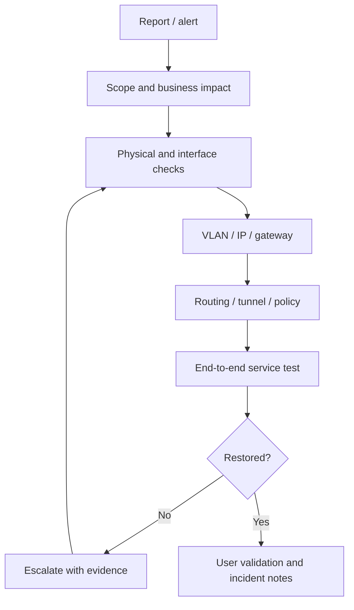

# Network Troubleshooting Scenarios & Practical Demos

These scenarios are sanitized learning and interview walkthroughs. They use fictional placeholders and do not represent a named customer incident or prove that the exact sequence occurred in production. They complement the experience-based case studies already listed in this folder.

## How I investigate

I establish impact and scope, preserve the initial state, trace the service path layer by layer, and change one thing at a time. I verify the service from both ends before closing the incident.



## Scenario 1 — OSPF over GRE is not forming adjacency

**Symptom:** Tunnel interface appears up, but OSPF neighbor remains Down/Init/ExStart or routes are missing.

Check in this order:
1. Underlay reachability between GRE endpoints.
2. GRE source, destination, tunnel IP, and interface state.
3. MTU and fragmentation behavior, especially if there is additional encapsulation.
4. OSPF area, hello/dead timers, network type, authentication, and router ID.
5. ACL/firewall treatment of OSPF protocol 89.
6. Neighbor state, route installation, and return path.

Cisco IOS/IOS-XE example:
```text
show interface tunnel <id>
show ip ospf interface tunnel <id>
show ip ospf neighbor
show ip route ospf
ping <remote-tunnel-ip> source <local-tunnel-ip>
```

A tunnel being administratively/protocol up does not prove the overlay routing protocol is healthy.

## Scenario 2 — BGP is Established but a prefix is missing

**Symptom:** Peer is Established, but the expected route is not installed.

- Check the correct address family and peer activation.
- Inspect received and advertised routes.
- Review prefix-lists, route-maps/policy, communities, local preference, MED, and next-hop reachability.
- Confirm route eligibility and RIB installation.
- Compare both sides before modifying policy.

Cisco:
```text
show ip bgp summary
show ip bgp neighbors <peer> routes
show ip bgp neighbors <peer> advertised-routes
show ip route <prefix>
```

Juniper:
```text
show bgp summary
show route receive-protocol bgp <peer>
show route advertising-protocol bgp <peer>
show route <prefix> detail
```

## Scenario 3 — One site cannot reach a data-centre service

**Symptom:** Local gateway responds, but selected DC services fail.

- Confirm whether one host, subnet, application, or entire site is affected.
- Check access VLAN, gateway, ARP, route table, and policy.
- Trace the path and confirm the return route.
- Check WAN/provider handoff counters, optical status, and circuit status.
- Coordinate with the provider using timestamps and sanitized test evidence.
- Validate the application with its service owner after network recovery.

## Incident update example

> We have confirmed that the local gateway is responding. The failure appears to be beyond the site LAN, and we are checking the WAN handoff and routing path. No broad configuration change has been made. We will share the next update after the fault domain is confirmed.

## Change safety mini-checklist

- Capture pre-change configuration and operational state.
- Confirm approval, scope, dependencies, maintenance window, and user impact.
- Prepare a tested or reviewed rollback path.
- Apply one controlled change.
- Verify routing, reachability, monitoring, and application behavior.
- Record actual outcome, evidence, and follow-up owner.

Do not paste example commands into production without validating platform, release, syntax, dependencies, and change approval.

---

**A note on this documentation:** The technical work and experience behind these notes are mine. Some wording and the way I have organized the material have had AI assistance, mainly to make the writing clearer and save time. The examples, decisions and work described are not AI-generated. I check what I publish and stand behind it.
