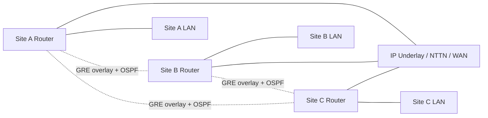

# Enterprise Multi-site Overlay Architecture Reference

**Type:** Illustrative logical reference, not a representation of a live customer network  
**Topics:** Underlay reachability, GRE overlay, OSPF, site routing and operational controls

## Design intent

This reference illustrates how multiple sites may exchange selected routes over GRE tunnels using OSPF, provided the IP underlay can reach the remote tunnel endpoints.

The actual topology, routing policy, redundancy model and security controls must be designed for the target environment. This diagram is not evidence of a specific deployment.

## Logical topology

Dashed links represent logical overlay relationships. The underlay is responsible for endpoint reachability; OSPF exchanges approved site routes over the overlay.

## Control-plane and data-plane view

- **Underlay:** Provides reachability to remote tunnel endpoint addresses.
- **GRE overlay:** Encapsulates routed traffic between tunnel endpoints.
- **OSPF:** Forms adjacencies over the configured tunnel interfaces and advertises approved prefixes.
- **Policy:** Route filters, metrics and redistribution controls limit route propagation.
- **Security:** GRE alone does not encrypt. Apply IPsec or another approved protection mechanism where required.

## Design checklist

### Addressing and routing
- Use non-overlapping site and tunnel addressing.
- Ensure tunnel endpoint routes resolve through the underlay.
- Prevent recursive routing through the overlay.
- Define OSPF areas, interface network types, authentication and timers consistently.
- Filter prefixes and control redistribution at routing boundaries.

### Resilience
- Identify single points of failure in transport, devices and tunnel endpoints.
- Define alternate paths and routing preference only where they are supported by the actual design.
- Validate failure detection and convergence in a controlled test window.
- Do not claim redundancy or automatic failover until it has been tested.

### MTU and performance
- Account for GRE and any additional security encapsulation overhead.
- Validate path MTU and fragmentation behavior.
- Monitor loss, latency, jitter and interface errors where relevant.
- Test application traffic, not only ICMP reachability.

### Operations and change control
- Maintain an approved source-of-truth topology and configuration backup.
- Record pre-change state, expected impact, rollback and validation criteria.
- Verify underlay, tunnel, routing and application layers after a change.
- Monitor adjacency flaps, route changes, tunnel counters and service reachability.

## Documentation-only addressing

If a future example requires IP addresses, use documentation ranges such as 192.0.2.0/24, 198.51.100.0/24 and 203.0.113.0/24 for IPv4 examples. Do not publish real customer, provider or production addresses.

## Evidence standard

A reference diagram demonstrates design understanding, not a verified implementation. To present a real project as evidence, add only authorized and sanitized material: reviewed topology, platform/version details, redacted routing output, test scope, observed results and change approval references.

---

**A note on this documentation:** The technical work and experience behind these notes are mine. Some wording and the way I have organized the material have had AI assistance, mainly to make the writing clearer and save time. The examples, decisions and work described are not AI-generated. I check what I publish and stand behind it.
