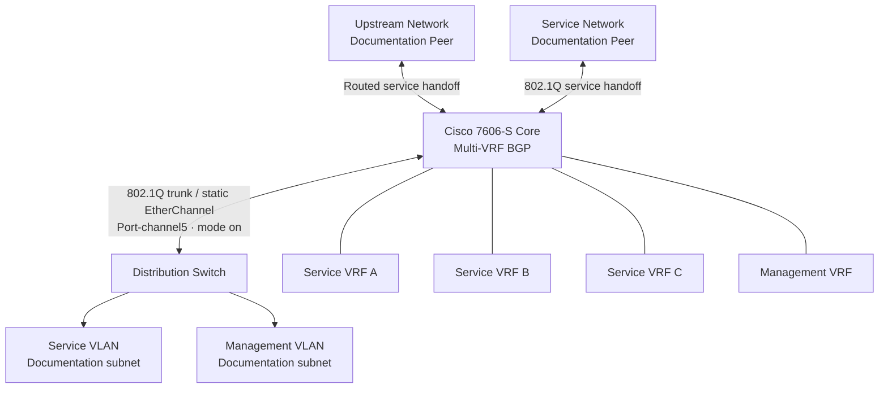
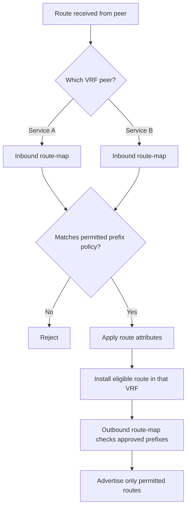
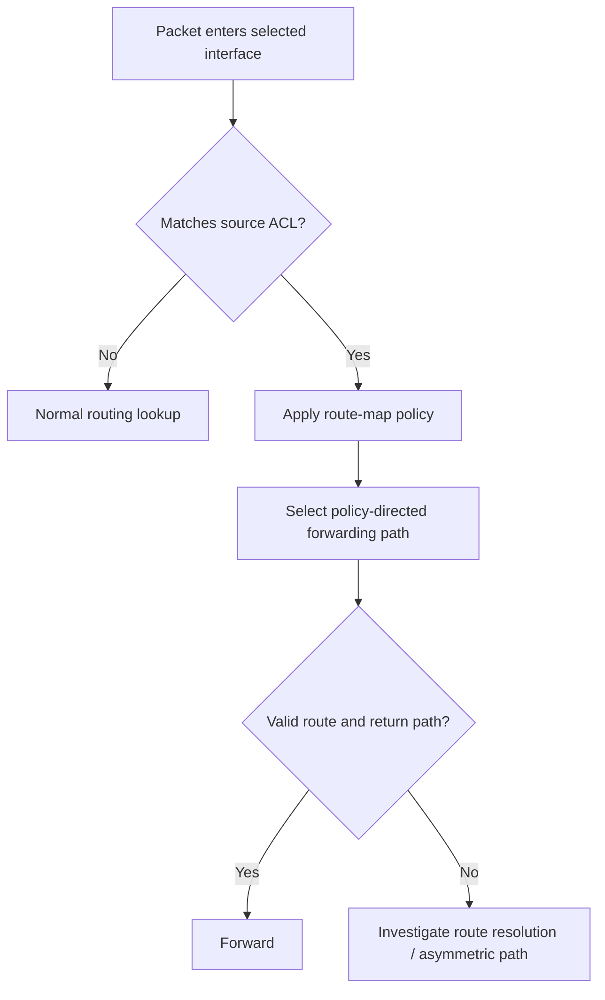

# Cisco 7606-S: Topology and Packet Flow

The diagrams below show the logical relationships used in this example. Names and addresses are fictional and do not identify a live network.

## Logical topology

## BGP route-policy flow

## PBR forwarding flow

## Layer 2 aggregation

The configuration example uses static EtherChannel with `channel-group 5 mode on`. It does not negotiate LACP. Both ends of the bundle must be configured consistently, including member interfaces and trunk settings.

The switching example documents PVST. It does not claim to demonstrate Rapid-PVST+.
