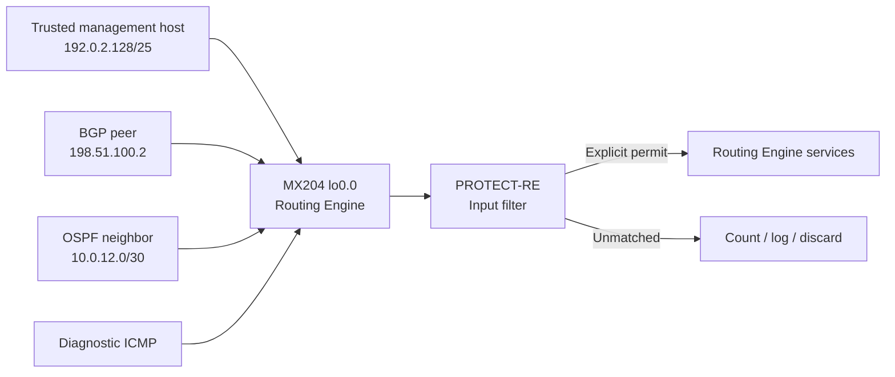
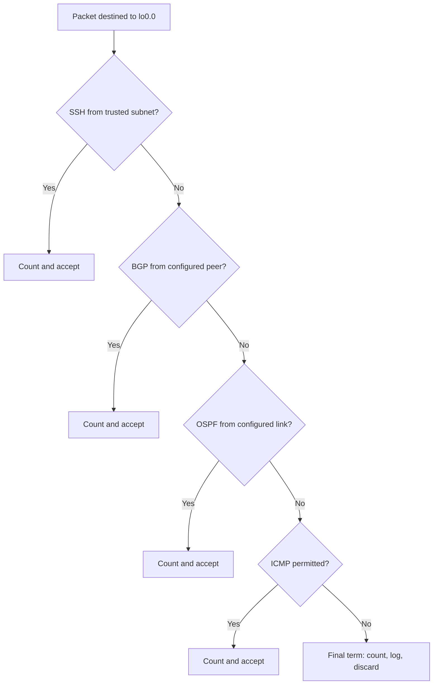
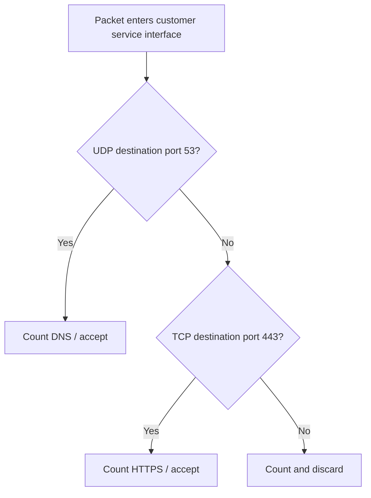

# MX204 Firewall Filters: Topology and Packet Flow

## Routing Engine protection concept

## Filter term decision flow

## Service-interface filter concept

**Critical safety note:** The lo0 attachment is commented out in the example configuration on purpose. The allow-list is not a complete management-plane service matrix. Before attaching a restrictive filter, account for every enabled service, including NETCONF, SSH, SNMP, NTP, DNS, AAA, BFD, routing protocols, monitoring, and automation. Use console/OOB access and a confirmed commit.

---

**A note on this documentation:** The technical work and experience behind these notes are mine. Some wording and the way I have organized the material have had AI assistance, mainly to make the writing clearer and save time. The examples, decisions and work described are not AI-generated. I check what I publish and stand behind it.
