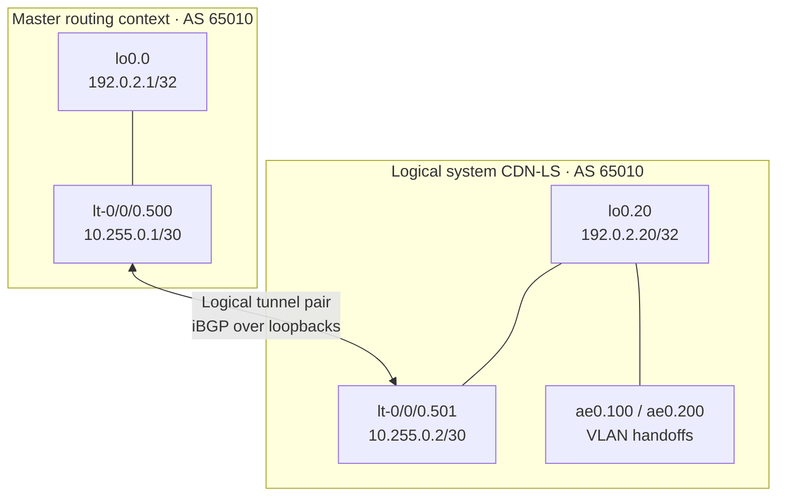
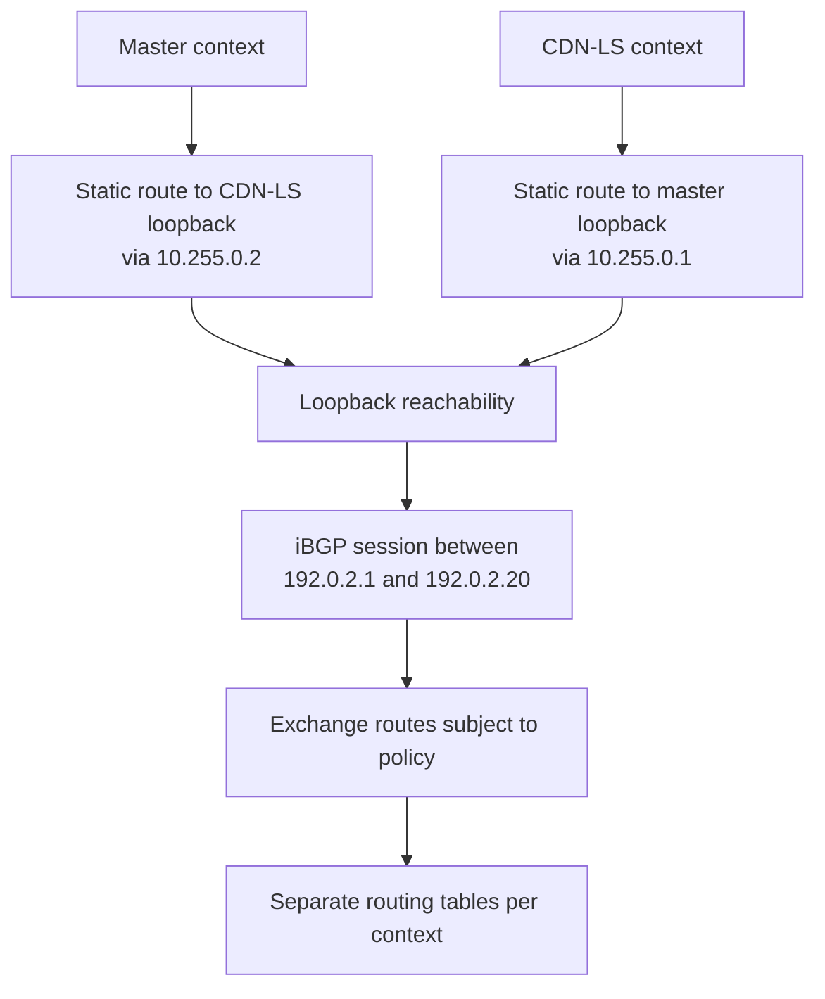

# MX204 Logical Systems: Topology and Route Flow

## Master and CDN-LS logical topology

## Route exchange concept

The paired logical-tunnel units provide an internal routed connection between the master and CDN-LS contexts. Each context has its own loopback and routing process. The same AS on both sides makes the BGP session iBGP.

The ae0 VLAN units are service handoffs inside CDN-LS. Confirm physical interface ownership, aggregate configuration, encapsulation, and logical-system feature support for the exact MX204/Junos release.

---

**A note on this documentation:** The technical work and experience behind these notes are mine. Some wording and the way I have organized the material have had AI assistance, mainly to make the writing clearer and save time. The examples, decisions and work described are not AI-generated. I check what I publish and stand behind it.
