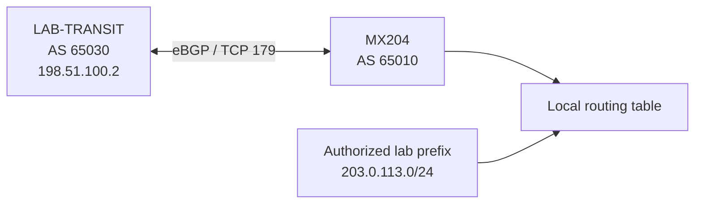
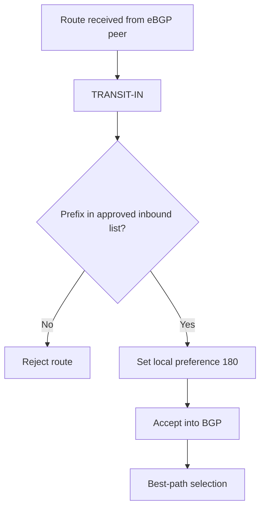
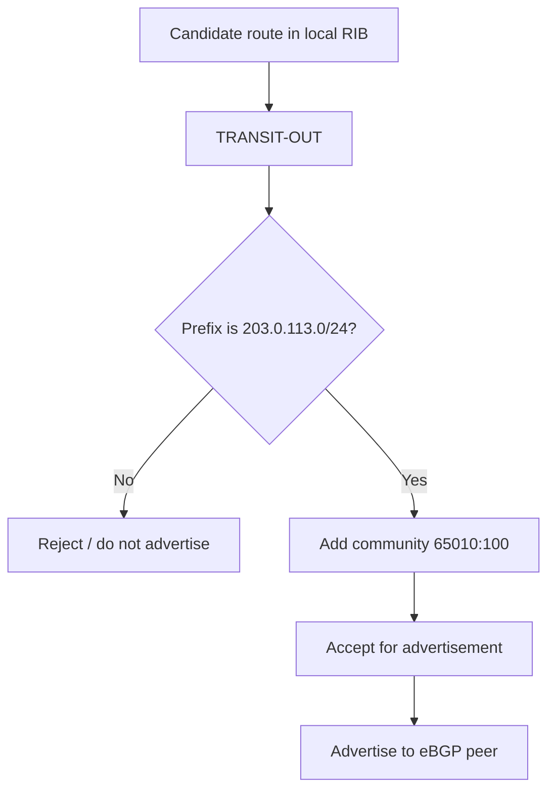

# MX204 BGP Policy: Topology and Route Flow

## eBGP lab topology

## Inbound policy flow

## Outbound policy flow

The alternate prepend policy adds the local AS twice before export. It is defined separately and is not active by default. A remote network may still choose another path based on its own policy.

This is a route-policy diagram. Ensure peer link addressing and peer-side configuration are consistent in a complete two-router lab. ASNs and prefixes are fictional.

---

**A note on this documentation:** The technical work and experience behind these notes are mine. Some wording and the way I have organized the material have had AI assistance, mainly to make the writing clearer and save time. The examples, decisions and work described are not AI-generated. I check what I publish and stand behind it.
