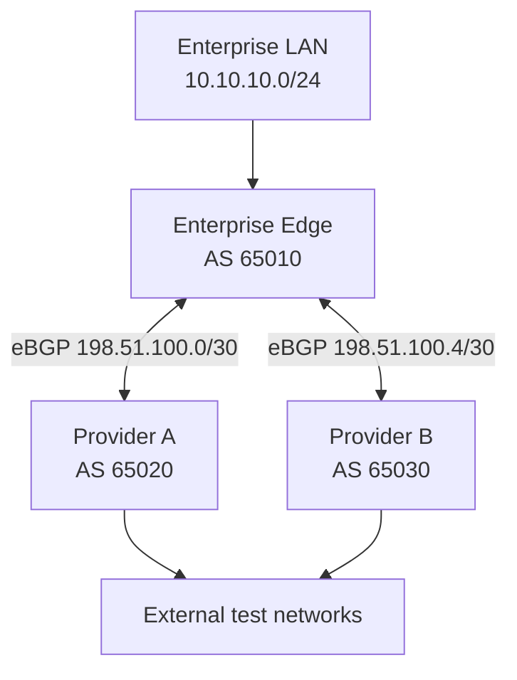

# Advanced BGP Lab: Dual-ISP Traffic Engineering

**Evidence type:** Lab/demo reference  
**Platform:** Cisco IOS / IOS-XE-style configuration  
**Scenario:** One enterprise edge router connected to two upstream providers using eBGP  
**Validation status:** Configuration reference only. Run in a controlled emulator or lab and record the exact image/release before marking it tested.  
**Addressing:** All prefixes and ASNs below are documentation-only examples.

## 1. Objective

Build a dual-provider BGP edge and practise:

- Establishing two eBGP sessions.
- Filtering received and advertised prefixes.
- Preferring one provider for outbound traffic with Local Preference.
- Influencing inbound path selection with AS-PATH prepending.
- Tagging routes with BGP Communities.
- Verifying the control plane and forwarding path.
- Troubleshooting a failed peer or unexpected route selection.

This lab is intentionally small enough to reproduce but includes policy controls that are often missing from basic neighbor-only examples.

## 2. Topology



| Device | ASN | Interface / peer | Address |
|---|---:|---|---|
| Enterprise CE | 65010 | G0/0 to Provider A | 198.51.100.2/30 |
| Provider A | 65020 | CE peer | 198.51.100.1/30 |
| Enterprise CE | 65010 | G0/1 to Provider B | 198.51.100.6/30 |
| Provider B | 65030 | CE peer | 198.51.100.5/30 |
| Enterprise LAN | - | Advertised aggregate | 203.0.113.0/24 |

The provider routers are represented as upstream peers. Their internal routing and the public Internet are outside this lab's scope.

## 3. Design decisions

### Outbound path preference

The enterprise AS receives a default route from each provider. It assigns:

- Provider A: Local Preference 200 (preferred).
- Provider B: Local Preference 100 (backup).

Within the same local AS, the higher Local Preference is preferred, assuming other BGP decision factors do not override the result earlier in the decision process.

### Inbound path influence

The enterprise advertises the same aggregate to both providers, but prepends its own ASN three additional times on the advertisement to Provider B.

This is an influence, not a guarantee. Remote networks apply their own policies and may choose a different path. Local Preference is not transmitted to external ASes.

### Prefix policy

- Accept only the default route from each upstream in this simplified lab.
- Advertise only the enterprise aggregate.
- Deny all other prefixes by explicit policy.
- Tag accepted routes with a lab community for policy visibility.

## 4. Pre-checks

1. Confirm the selected IOS/IOS-XE image supports the commands used.
2. Confirm both peer interfaces have IP reachability.
3. Confirm the local LAN aggregate exists in the routing table before using a BGP network statement.
4. Confirm the provider peers are configured to advertise the default route in the emulator.
5. Save the baseline and confirm console/out-of-band access.
6. Do not use these fictional ASNs or documentation prefixes in a live routing domain.

## 5. Enterprise CE configuration

### Interfaces and local aggregate

```cisco
hostname CE-EDGE

interface GigabitEthernet0/0
 description EBGP-TO-PROVIDER-A
 ip address 198.51.100.2 255.255.255.252
 no shutdown

interface GigabitEthernet0/1
 description EBGP-TO-PROVIDER-B
 ip address 198.51.100.6 255.255.255.252
 no shutdown

interface Loopback10
 description LAB-ENTERPRISE-AGGREGATE
 ip address 203.0.113.1 255.255.255.0
```

The loopback is used here to ensure the exact aggregate exists in the local routing table. In a real design, advertise only a prefix that the enterprise is authorized to originate and can safely route.

### Prefix lists

```cisco
ip prefix-list DEFAULT-ONLY seq 5 permit 0.0.0.0/0

ip prefix-list ENTERPRISE-OUT seq 5 permit 203.0.113.0/24
```

The default-only prefix list matches the exact default route, not arbitrary more-specific routes. The outbound list permits only the enterprise /24.

### Inbound route maps

```cisco
route-map ISP-A-IN permit 10
 match ip address prefix-list DEFAULT-ONLY
 set local-preference 200
 set community 65010:101 additive

route-map ISP-A-IN deny 100

route-map ISP-B-IN permit 10
 match ip address prefix-list DEFAULT-ONLY
 set local-preference 100
 set community 65010:102 additive

route-map ISP-B-IN deny 100
```

The explicit deny sequence makes the intended policy clear. The community values are illustrative local tags. They do not cause a provider action unless the receiving network has a matching policy.

### Outbound route maps

```cisco
route-map ISP-A-OUT permit 10
 match ip address prefix-list ENTERPRISE-OUT

route-map ISP-A-OUT deny 100

route-map ISP-B-OUT permit 10
 match ip address prefix-list ENTERPRISE-OUT
 set as-path prepend 65010 65010 65010

route-map ISP-B-OUT deny 100
```

Provider B receives a longer AS path for the enterprise aggregate. Provider A receives the normal path. Remote networks may still prefer Provider B due to their own policies.

### BGP process

```cisco
router bgp 65010
 bgp log-neighbor-changes
 neighbor 198.51.100.1 remote-as 65020
 neighbor 198.51.100.5 remote-as 65030

 address-family ipv4
  network 203.0.113.0 mask 255.255.255.0

  neighbor 198.51.100.1 activate
  neighbor 198.51.100.1 route-map ISP-A-IN in
  neighbor 198.51.100.1 route-map ISP-A-OUT out
  neighbor 198.51.100.1 send-community

  neighbor 198.51.100.5 activate
  neighbor 198.51.100.5 route-map ISP-B-IN in
  neighbor 198.51.100.5 route-map ISP-B-OUT out
  neighbor 198.51.100.5 send-community
 exit-address-family
```

Check the platform's address-family syntax and whether standard communities are sent by default. The explicit send-community command is included to make the intent visible.

## 6. Policy behaviour explained

| Policy | Direction | Expected effect |
|---|---|---|
| DEFAULT-ONLY | Inbound | Accept only 0.0.0.0/0 |
| ISP-A-IN | Inbound from A | Set Local Preference 200 |
| ISP-B-IN | Inbound from B | Set Local Preference 100 |
| ENTERPRISE-OUT | Outbound | Permit only 203.0.113.0/24 |
| ISP-A-OUT | Outbound to A | Advertise normal AS path |
| ISP-B-OUT | Outbound to B | Advertise with additional AS prepends |
| Community tags | Inbound | Identify which peer supplied the accepted default |

**Remember:**

- Local Preference is an internal-AS path-selection attribute and is not normally propagated to external eBGP peers.
- AS-PATH prepending influences how some remote ASes compare paths. It cannot force a remote network to use a particular provider.
- Communities are labels. Their effect depends on the policy of the network that receives them.
- A BGP session in Established state does not prove that the intended prefixes are accepted or installed.

## 7. Verification

Run the equivalent commands supported by the selected IOS/IOS-XE release.

### Peer state

```cisco
show ip bgp summary
show ip bgp neighbors 198.51.100.1
show ip bgp neighbors 198.51.100.5
```

Expected: both sessions reach Established. Check uptime, received prefixes and notification/reset counters.

### Received routes and best path

```cisco
show ip bgp
show ip bgp 0.0.0.0
show ip route 0.0.0.0
show ip protocols
```

Expected in the simplified lab: the default learned from Provider A has the higher Local Preference and is selected, assuming both routes are otherwise eligible and no earlier decision criterion changes the result.

### Advertised routes

```cisco
show ip bgp neighbors 198.51.100.1 advertised-routes
show ip bgp neighbors 198.51.100.5 advertised-routes
```

Expected: only 203.0.113.0/24 is advertised. Confirm the AS path shown to Provider B includes the additional prepends.

### Policy inspection

```cisco
show route-map
show ip prefix-list
show running-config | section router bgp
```

Confirm the policy is attached in the intended direction and to the intended neighbor.

### Forwarding and service verification

```cisco
show ip route
show ip cef 0.0.0.0
ping <APPROVED-REMOTE-TEST-IP> source <ENTERPRISE-SOURCE-IP>
traceroute <APPROVED-REMOTE-TEST-IP>
```

Use an approved test destination in a controlled lab. Verify the actual forwarding path and application reachability, not just the BGP table.

## 8. Failure and troubleshooting scenarios

| Symptom | Investigation | Possible explanation |
|---|---|---|
| Peer stuck in Active | Interface, route to peer, TCP 179, remote ASN, ACL, source address | Reachability or session parameter issue |
| Peer Established, zero accepted routes | Received-routes capability, inbound policy, provider advertisement | Prefix list rejects everything or provider sends no route |
| Both defaults accepted, wrong path selected | Local Preference, weight, route-map attachment, next-hop, other BGP attributes | Intended policy not applied or another decision factor wins |
| Aggregate not advertised | Exact route in RIB, network mask, outbound policy, next-hop validity | BGP network statement has no matching route or policy denies it |
| Provider B sees no prepend | Advertised-routes output and route-map sequence | Wrong policy attachment or prefix does not match |
| Traffic exits unexpected provider | RIB, CEF/FIB, PBR, more-specific routes, provider path | Forwarding decision differs from assumed default-route selection |
| Session repeatedly resets | Interface errors, logs, peer timers, CPU, transport stability | Underlay instability or control-plane/resource issue |

### A disciplined fault-isolation order

1. Physical/interface and peer IP reachability.
2. TCP session and BGP neighbor state.
3. Received route availability.
4. Inbound route policy and accepted routes.
5. BGP best-path attributes and next-hop resolution.
6. Routing table and forwarding table.
7. Return path and application-level verification.

Do not clear all BGP sessions as a first response. Identify the affected peer and assess the service impact before using a reset command.

## 9. Failover test plan

In an isolated lab, test one change at a time:

1. Establish both peers and record the baseline.
2. Confirm Provider A is preferred for the default route.
3. Simulate Provider A failure by shutting its lab-facing interface or removing its lab session.
4. Confirm Provider B remains Established and its default route becomes the selected eligible path.
5. Verify the forwarding table and test traffic through the remaining path.
6. Restore Provider A and observe route selection/convergence.
7. Record timestamps, route changes, packet loss and application test results.

Do not invent convergence or packet-loss figures. Capture actual results from the lab. A production failover test requires an approved change window, impact assessment and rollback plan.

## 10. Operational safeguards and production considerations

- Use explicit import and export policies; do not accept or advertise unrestricted routes.
- Validate provider prefix limits, route filtering, bogon/RPKI policy and maximum-prefix support according to the provider agreement and platform.
- Protect the BGP control plane and restrict peer reachability.
- Use authentication and TTL security where supported and agreed by both peers.
- Review route leak and accidental transit risks before enabling advertisements.
- Confirm the aggregate is authorized, covered by the relevant routing registry/IRR and RPKI ROA where applicable.
- Understand provider communities and their documented meaning before sending them.
- Consider graceful restart, BFD, route dampening and convergence features only after reviewing platform support and operational trade-offs.
- Maintain a known-good configuration and independent management access.

This lab intentionally omits provider-specific community actions, RPKI deployment and production-grade security configuration. Those require a separate design and validation.

## 11. Change and rollback checklist

Before a live change, document:

- Change owner, approval, maintenance window and stakeholders.
- Current peer state, received/advertised prefixes and best path.
- Existing route maps, prefix lists and neighbor configuration.
- Expected inbound and outbound policy changes.
- Out-of-band access and rollback trigger.
- Service tests and post-change monitoring.

Rollback should restore the saved, approved policy and neighbor configuration using the platform's supported procedure. Re-verify peer state, routes, forwarding and application reachability after rollback.

## 12. What I learned / lab record

Complete this section only after running the lab:

- Emulator/device and exact software release:
- Configuration date:
- Peer state before and after:
- Accepted default routes:
- Selected best path and Local Preference:
- Advertised prefix to each peer:
- Observed AS path at each provider:
- Failover test result:
- Unexpected behaviour and troubleshooting evidence:
- What I would change or investigate next:

## 13. References

- [RFC 4271 - A Border Gateway Protocol 4 (BGP-4)](https://www.rfc-editor.org/rfc/rfc4271)
- [RFC 1997 - BGP Communities Attribute](https://www.rfc-editor.org/rfc/rfc1997)
- [RFC 4360 - BGP Extended Communities Attribute](https://www.rfc-editor.org/rfc/rfc4360)
- [RFC 7454 - BGP Operations and Security](https://www.rfc-editor.org/rfc/rfc7454)
- [Cisco BGP configuration guide](https://www.cisco.com/c/en/us/support/ios-nx-os-software/border-gateway-protocol-bgp/tsd-products-support-series-home.html)

## Related material

- [BGP fundamentals lab](./README.md)
- [Juniper MX204 BGP policy lab](../bgp-policy/README.md)
- [Network documentation guide](../../DOCUMENTATION-GUIDE.md)
- [OSPF over GRE multi-site case study](../../case-studies/ospf-over-gre-multisite-routing.md)
