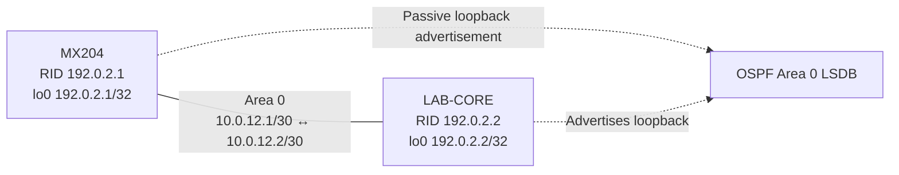
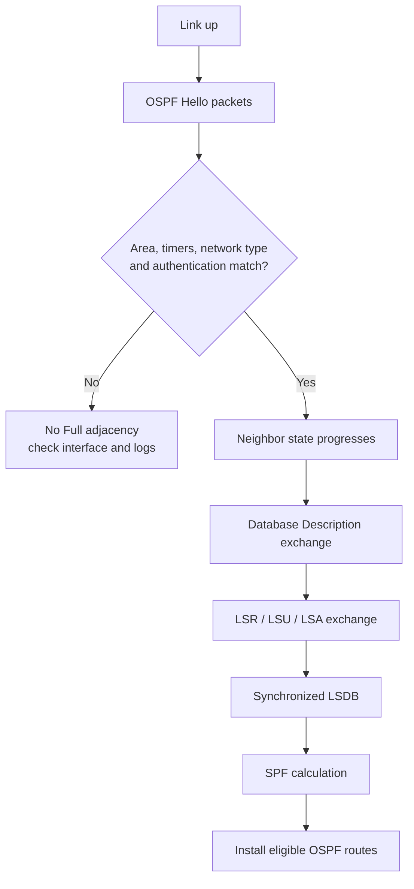

# MX204 OSPF: Topology and Packet Flow

## Area 0 topology

## OSPF control-plane flow

The MX204 loopback is passive: its prefix is advertised but it does not form an adjacency. The routed link forms the adjacency. The remote router must advertise 192.0.2.2/32 for the MX204 to learn it.

Both ends must agree on area, timers, network type, and authentication. This diagram describes OSPF control-plane behavior, not user-packet forwarding.
