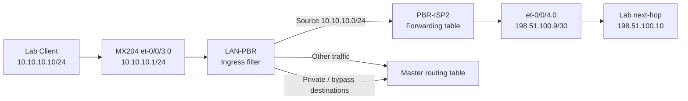
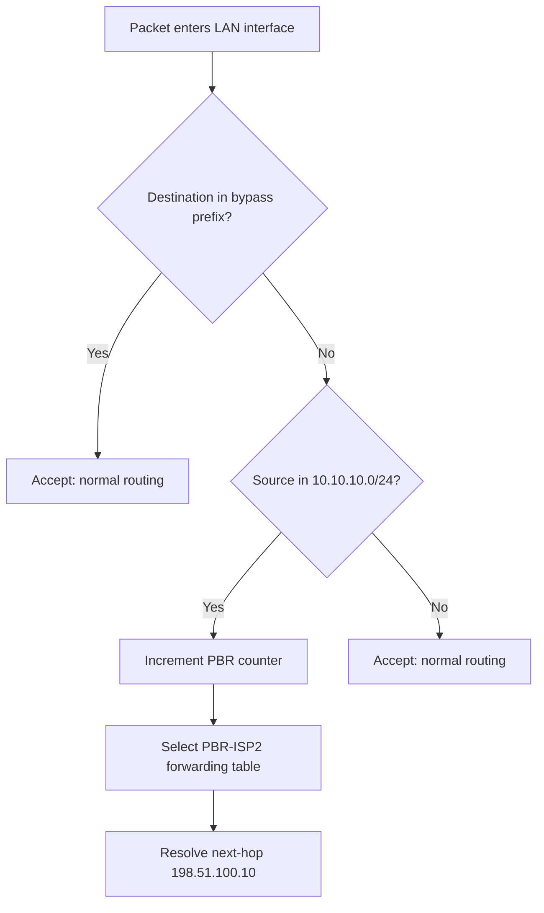

# MX204 PBR: Topology and Packet Flow

## Logical topology

## Packet decision flow

## Reading the diagram
1. Traffic enters the MX204 from the lab LAN.
2. The filter checks bypass destinations first.
3. Matching source traffic is directed to the PBR forwarding table.
4. Unmatched traffic follows the master routing table.

**Important:** Confirm route resolution, return routing, filter direction, and Junos forwarding-instance support in the target lab. Addresses are documentation values.

---

**A note on this documentation:** The technical work and experience behind these notes are mine. Some wording and the way I have organized the material have had AI assistance, mainly to make the writing clearer and save time. The examples, decisions and work described are not AI-generated. I check what I publish and stand behind it.
