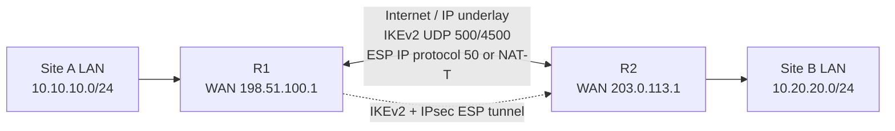

# Site-to-Site IPsec VPN Lab (IKEv2)

**Evidence type:** Lab/demo reference  
**Platform:** Cisco IOS / IOS-XE-style CLI; exact syntax and crypto support vary by model and release  
**Design:** Policy-based site-to-site IPsec using IKEv2 and a crypto map  
**Validation status:** Configuration reference only. Not yet executed on a named emulator, physical router or software release.  
**Addressing:** Documentation-only example prefixes. All credentials below are placeholders and must be replaced in a lab.

## 1. Purpose

Build an authenticated, encrypted IPsec tunnel between two routed sites. The example focuses on the control plane (IKEv2), data plane (IPsec ESP), protected traffic selectors, security associations, and end-to-end verification.

This is a policy-based example: an access control list identifies traffic to protect, and a crypto map applies the IPsec policy to the WAN interface. A route-based VPN using virtual tunnel interfaces is a different design and is not configured in this page.

## 2. Topology



| Parameter | Site A / R1 | Site B / R2 |
|---|---|---|
| WAN interface | G0/0 | G0/0 |
| WAN address | 198.51.100.1/30 | 203.0.113.1/30 |
| Protected LAN | 10.10.10.0/24 | 10.20.20.0/24 |
| Peer address | 203.0.113.1 | 198.51.100.1 |
| IKE version | IKEv2 | IKEv2 |
| Authentication | Pre-shared key (lab only) | Same pre-shared key (lab only) |
| IPsec mode | Tunnel | Tunnel |

The two WAN prefixes represent separate provider-facing networks. The intervening Internet/transport is abstracted; provide actual underlay reachability in your lab.

## 3. How the tunnel works

1. A host sends traffic from one protected LAN to the other.
2. The crypto ACL identifies the packet as interesting traffic.
3. IKEv2 negotiates and authenticates the peers, then establishes an IKE SA.
4. The peers negotiate IPsec Child SAs and matching traffic selectors.
5. ESP protects the matching packets between the WAN peer addresses.
6. The receiving peer decrypts and forwards the original packet to its LAN.

IKEv2 control traffic commonly uses UDP 500 and UDP 4500 when NAT traversal is in use. Native ESP is IP protocol 50, not TCP or UDP port 50. If NAT is present, confirm NAT-T negotiation and ensure upstream devices permit the required traffic.

## 4. Security choices and prerequisites

This lab uses a modern illustrative proposal:

- IKEv2 encryption: AES-256-CBC.
- IKE integrity/PRF: SHA-256.
- Diffie-Hellman group: 14.
- IPsec ESP encryption: AES-256.
- ESP integrity: SHA-256 HMAC.
- Authentication: pre-shared key for lab simplicity.

These settings are examples, not a universal enterprise standard. Prefer certificate-based authentication where appropriate and follow your organization's cryptographic baseline. Confirm the exact platform supports the selected algorithms and DH group. Do not reuse a production key or publish any real key in a repository.

Before configuration:

- Confirm both peers can reach each other's WAN addresses.
- Confirm LAN prefixes are non-overlapping and correctly routed.
- Confirm firewalls/ACLs allow IKE and ESP or NAT-T.
- Identify whether NAT exists between peers.
- Exclude protected traffic from internet PAT/NAT where required by the design.
- Agree on IKE and IPsec proposals, identities, lifetimes and traffic selectors.
- Save a baseline and arrange console/out-of-band access.

## 5. Site A / R1 configuration

Replace every angle-bracket placeholder locally. Do not commit a real key. The WAN address and interface below are documentation examples.

### WAN interface

```cisco
hostname R1-SITE-A

interface GigabitEthernet0/0
 description WAN-TO-TRANSPORT
 ip address 198.51.100.1 255.255.255.252
 no shutdown
```

### IKEv2 proposal and policy

```cisco
crypto ikev2 proposal IKEV2-PROP
 encryption aes-cbc-256
 integrity sha256
 group 14

crypto ikev2 policy IKEV2-POLICY
 proposal IKEV2-PROP
```

### Keyring and IKEv2 profile

```cisco
crypto ikev2 keyring VPN-KEYRING
 peer SITE-B
  address 203.0.113.1
  pre-shared-key local <SITE_A_LAB_PSK>
  pre-shared-key remote <SITE_A_LAB_PSK>

crypto ikev2 profile VPN-IKEV2
 match identity remote address 203.0.113.1 255.255.255.255
 identity local address 198.51.100.1
 authentication remote pre-share
 authentication local pre-share
 keyring local VPN-KEYRING
```

The same lab PSK is shown on both sides for clarity. Use a long, unique, randomly generated secret in a private lab, store it securely, and never place the actual value in Git. Some IOS releases support different identity and keyring syntax; check the command reference for the exact release.

### IPsec proposal and traffic selector

```cisco
crypto ipsec transform-set ESP-SET esp-aes 256 esp-sha256-hmac
 mode tunnel

ip access-list extended VPN-TRAFFIC
 permit ip 10.10.10.0 0.0.0.255 10.20.20.0 0.0.0.255
```

The ACL defines the local-to-remote protected traffic. The peer uses the reverse source/destination direction. It is not a general-purpose WAN firewall policy.

### Crypto map and interface attachment

```cisco
crypto map VPN-MAP 10 ipsec-isakmp
 set peer 203.0.113.1
 set transform-set ESP-SET
 set ikev2-profile VPN-IKEV2
 match address VPN-TRAFFIC

interface GigabitEthernet0/0
 crypto map VPN-MAP
```

## 6. Site B / R2 configuration

The peer configuration must mirror Site A with local and remote values reversed.

### WAN interface

```cisco
hostname R2-SITE-B

interface GigabitEthernet0/0
 description WAN-TO-TRANSPORT
 ip address 203.0.113.1 255.255.255.252
 no shutdown
```

### IKEv2 proposal and policy

```cisco
crypto ikev2 proposal IKEV2-PROP
 encryption aes-cbc-256
 integrity sha256
 group 14

crypto ikev2 policy IKEV2-POLICY
 proposal IKEV2-PROP
```

### Keyring and IKEv2 profile

```cisco
crypto ikev2 keyring VPN-KEYRING
 peer SITE-A
  address 198.51.100.1
  pre-shared-key local <SITE_B_LAB_PSK>
  pre-shared-key remote <SITE_B_LAB_PSK>

crypto ikev2 profile VPN-IKEV2
 match identity remote address 198.51.100.1 255.255.255.255
 identity local address 203.0.113.1
 authentication remote pre-share
 authentication local pre-share
 keyring local VPN-KEYRING
```

Use the exact same secret value on both peers in this PSK example, but do not put it in the public repository.

### IPsec proposal and reverse traffic selector

```cisco
crypto ipsec transform-set ESP-SET esp-aes 256 esp-sha256-hmac
 mode tunnel

ip access-list extended VPN-TRAFFIC
 permit ip 10.20.20.0 0.0.0.255 10.10.10.0 0.0.0.255
```

### Crypto map and interface attachment

```cisco
crypto map VPN-MAP 10 ipsec-isakmp
 set peer 198.51.100.1
 set transform-set ESP-SET
 set ikev2-profile VPN-IKEV2
 match address VPN-TRAFFIC

interface GigabitEthernet0/0
 crypto map VPN-MAP
```

## 7. Routing and NAT considerations

The crypto ACL identifies packets for encryption; it does not create the LAN routes.

- Each site needs a connected or routed path to its local LAN.
- The remote LAN must be reachable through the peer's WAN-facing path so that matching packets encounter the crypto map.
- Do not accidentally send the protected traffic through internet PAT.
- If NAT is configured, create a NAT exemption/identity NAT rule for the protected source and destination prefixes, with syntax appropriate to the platform.
- Ensure the return path is symmetric enough for the intended stateful firewall and application design.
- Avoid overlapping LAN networks; overlapping address spaces require a separately designed NAT or segmentation solution.

NAT exemption commands are intentionally not included because IOS NAT syntax and order of operations vary by platform and existing configuration. Review the complete NAT policy before adding an exemption.

## 8. Verification workflow

Generate traffic between a host in 10.10.10.0/24 and a host in 10.20.20.0/24. Router-to-router pings alone may not match the protected LAN selectors.

### Underlay first

```cisco
show ip interface brief
show ip route 203.0.113.1
ping 203.0.113.1 source 198.51.100.1
```

On R2, reverse the peer and source. Confirm ordinary IP reachability before investigating IKE.

### IKEv2 control plane

```cisco
show crypto ikev2 sa
show crypto ikev2 profile
show crypto session detail
```

Expected: an IKEv2 SA is established with the intended peer and authentication/identity. Exact output varies by release.

### IPsec data plane

```cisco
show crypto ipsec sa
show crypto session
show crypto map
```

Expected after interesting traffic:

- Correct local and remote crypto identities/selectors.
- Inbound and outbound ESP SAs.
- Encapsulation and encryption counters increase on the sending peer.
- Decapsulation and decryption counters increase on the receiving peer.
- No persistent authentication, replay or encapsulation errors.

A negotiated IKE SA without increasing IPsec data counters may mean no matching traffic is being generated or the selectors/policy do not match.

### End-to-end test

From a Site A host, ping or test an approved service on a Site B host, then repeat in the reverse direction. Check host firewalls, default gateways, routes, ACLs and application listeners. Capture evidence on both routers and endpoints.

## 9. Troubleshooting matrix

| Symptom | Check | Common possibilities |
|---|---|---|
| No IKE SA | Peer reachability, UDP 500/4500, IKE policy, identity, keyring | Underlay block, proposal mismatch, wrong peer identity or PSK |
| IKE authentication failure | IKE logs, local/remote identity, keyring match | Incorrect secret, identity mismatch, wrong keyring peer |
| IKE SA up, no IPsec SA | Crypto ACL, transform set, profile attachment, traffic selectors | Phase 2/Child SA proposal or selector mismatch |
| IPsec SA up, counters stay zero | Generate matching LAN-to-LAN traffic, inspect ACL hit counters and routes | No interesting traffic, wrong ACL, wrong route |
| Encapsulation rises, decapsulation does not | Remote peer, NAT-T, ESP/UDP 4500 filtering, remote SA and logs | One-way transport, peer policy mismatch or filtering |
| Decryption works, application fails | Return route, host gateway/firewall, NAT, service listener | LAN routing or endpoint issue |
| Large packets fail | Path MTU, fragmentation, DF probes, MSS and encapsulation overhead | MTU black hole or fragmentation handling |
| Tunnel works until rekey | IKE/IPsec lifetimes, rekey logs, proposal compatibility, clocks | Rekey negotiation or platform interoperability issue |

Use targeted logging and debug only in a controlled window. High-volume crypto debugging can affect device performance and expose sensitive metadata. Disable debugging immediately after collecting the required evidence.

## 10. MTU, NAT-T and performance

IPsec encapsulation adds headers and integrity data, reducing the usable inner packet size. NAT-T adds UDP encapsulation. The exact overhead depends on IP version, algorithms, mode and options.

- Determine the actual path MTU end to end.
- Test large packets with the DF bit where supported.
- Review fragmentation and reassembly counters.
- Consider TCP MSS adjustment only after measuring and understanding the path.
- Monitor CPU and crypto throughput on the actual device.
- Do not copy a generic tunnel MTU or MSS value into production without testing.

## 11. Change control and rollback

Before a production change, document:

- Business services and subnets affected.
- Peer ownership, transport path and firewall dependencies.
- Current routes, NAT policy, crypto map, IKE/IPsec state and counters.
- Approved proposal, identity, authentication and selector values.
- Configuration backup, out-of-band access and rollback trigger.
- Stakeholder communication, validation owner and monitoring window.

Rollback should restore the saved, approved configuration using the platform's supported procedure. Remove only the new policy objects and interface attachment introduced by the change; do not delete shared crypto or NAT configuration without dependency review. After rollback, verify normal routing and service reachability.

## 12. Lab record - complete after testing

- Device/emulator and exact software release:
- Date and test topology:
- IKEv2 SA result:
- IPsec Child SA result:
- Negotiated algorithms:
- Traffic selector values:
- Encapsulation/decapsulation counters:
- NAT-T status:
- Bidirectional host/application test:
- MTU test and result:
- Failure injected and recovery evidence:
- What I learned / what remains to test:

Do not mark this page as validated until you have run it and captured your own output.

## 13. References

- [RFC 7296 - Internet Key Exchange Protocol Version 2 (IKEv2)](https://www.rfc-editor.org/rfc/rfc7296)
- [RFC 4301 - Security Architecture for the Internet Protocol](https://www.rfc-editor.org/rfc/rfc4301)
- [RFC 3947 - Negotiation of NAT-Traversal in the IKE](https://www.rfc-editor.org/rfc/rfc3947)
- [RFC 3948 - UDP Encapsulation of IPsec ESP Packets](https://www.rfc-editor.org/rfc/rfc3948)
- [Cisco IPsec VPN configuration and troubleshooting resources](https://www.cisco.com/c/en/us/support/security/vpn/tsd-products-support-series-home.html)

## Related portfolio pages

- [Tunnel technologies overview](./README.md)
- [OSPF over GRE lab walkthrough](../case-studies/ospf-over-gre-lab-walkthrough.md)
- [Dual-ISP BGP traffic engineering lab](../routing/bgp/dual-isp-traffic-engineering-lab.md)
- [Network documentation guide](../DOCUMENTATION-GUIDE.md)
